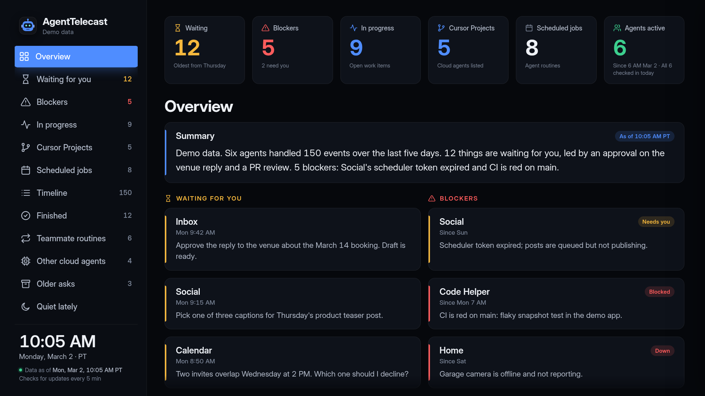
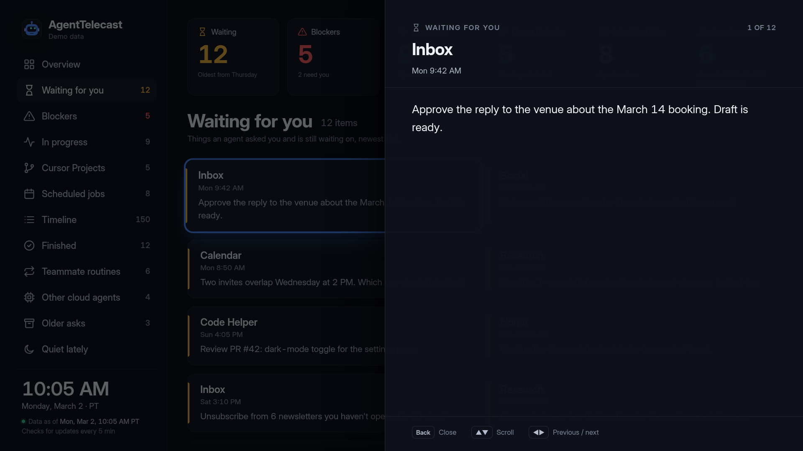
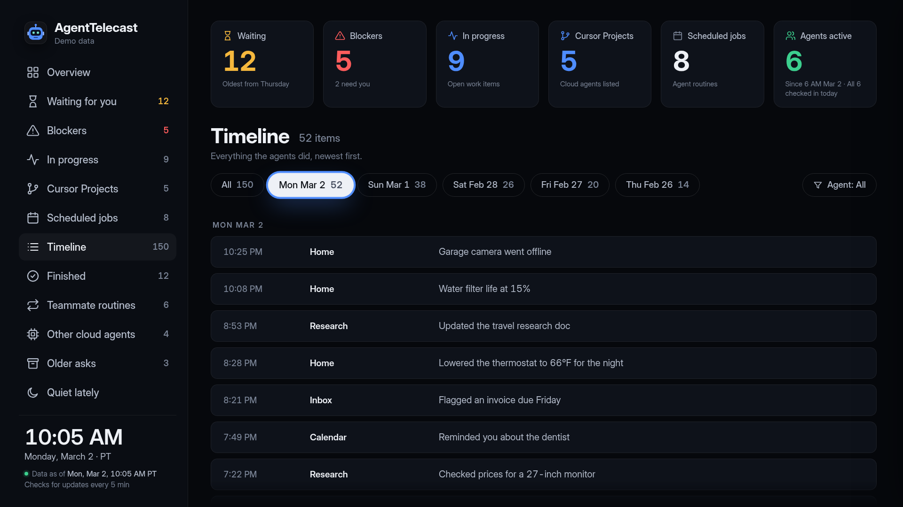
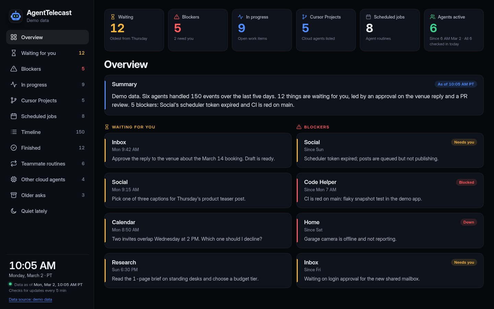
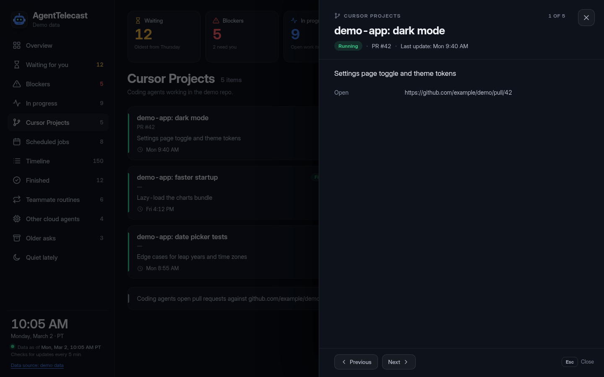
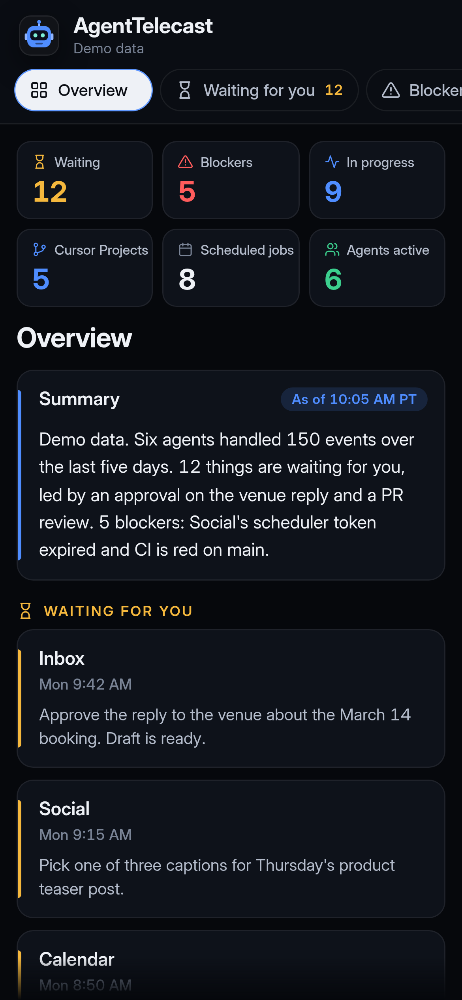

# AgentTelecast

An open-source dashboard for your SI agents, built for the TV remote. It runs in any browser too.

Take it and make it your own: point it at your agents' data, restyle it, fork it.

Setup guide and FAQ: https://remymazmanian.com/agenttelecast/



AgentTelecast puts what your agents are doing on one screen: what is waiting for you, what is blocked,
what is running, scheduled jobs, and a timeline of the last few days. It is a single HTML page that
reads one JSON file. On a TV you move around with the arrow keys and OK. In a browser it switches to
a desktop and phone layout.

All data in the screenshots and the demo is made up.

## Screenshots

| | |
|---|---|
|  |  |
| TV: details panel | TV: timeline, one tab per day |
|  |  |
| Desktop browser | Desktop: details panel |



More of the phone layout: [details](screenshots/web-phone-details.png), [timeline](screenshots/web-phone-timeline.png).

## Quick start (web)

You need [Node.js](https://nodejs.org) 18 or newer. Building has no other dependencies.

```sh
cd web
node build.cjs                       # demo data -> dist/index.html
node build.cjs my-feed.json          # your data -> dist/index.html
```

Open `dist/index.html` in a browser. It is one file with everything inside, so you can copy it
anywhere or serve it from any static web server, for example:

```sh
cd dist && python3 -m http.server 8080
```

To have the page load fresh data while it runs instead of baking it in:

```sh
node build.cjs --feed https://example.com/agenttelecast.json
```

or open any build with `index.html?data=<url of your feed>`. Add `?tv=1` to see the TV layout
in a desktop browser. Details are in [docs/DATA-FORMAT.md](docs/DATA-FORMAT.md#pointing-it-at-your-feed).

## Android TV

The app shows your page full screen and handles the remote. Download `AgentTelecast-1.0.0.apk` from the
[latest release](https://github.com/remymazmanian/agenttelecast/releases/latest). See
[release/README.md](release/README.md) for install steps. In short:

```sh
adb connect <tv-address>:5555
adb install AgentTelecast-1.0.0.apk
```

The app doesn't start by itself when the TV turns on. Open it from the TV's apps row.
On first launch it asks for the address of your page. **Test** checks that the TV can reach it,
**Save** opens the dashboard, and **Try demo** shows the built-in demo with no server at all.

To build the APK yourself (JDK 17+ and the Android SDK, no Gradle):

```sh
cd web && node build.cjs && cd ../android
./build.sh                                        # signs with a local key it creates once
APP_ID=com.example.myagenttelecast ./build.sh     # your own app id
```

`build.sh` lists its options at the top, including how to sign with your own keystore.

## Remote controls

| Button | What it does |
|---|---|
| Arrows | Move between sections and cards |
| OK | Open the highlighted card or section |
| Back | Close the open panel or step back; press twice quickly to exit the app |
| Hold OK, or MENU | Settings (page address, how often to look for new data, text zoom) |

In a browser the same keys work on the keyboard (Enter for OK, Esc or Backspace for Back), and you can
click or tap too.

**How often it looks for new data is up to you.** Move down past the last section to the footer line
("Looks for new data every 5 min") and press OK, or click it, to pick Off, 1, 5, 15 or 30 minutes, or
every hour. The footer shows your choice. You can also set it with `?refresh=15` in the address or in the
app's Settings. A feed can suggest a default with `meta.refreshMinutes`. See
[docs/DATA-FORMAT.md](docs/DATA-FORMAT.md#how-often-the-page-looks-for-new-data).

## The data feed

Everything on screen comes from one JSON file:

```json
{
  "summary": "Six agents handled 150 events over the last five days.",
  "metrics": [{ "value": "12", "label": "Waiting on you", "tone": "warning" }],
  "sections": [
    {
      "heading": "Waiting for you",
      "items": [{ "title": "Inbox", "lead": "Mon 9:42 AM", "body": "Approve the reply to the venue." }]
    }
  ],
  "meta": { "updatedAt": "2026-03-02T18:05:00Z" }
}
```

- [docs/DATA-FORMAT.md](docs/DATA-FORMAT.md): every field, how headings pick icons and colors, and
  how the top tiles are counted.
- [docs/agenttelecast-feed.schema.json](docs/agenttelecast-feed.schema.json): JSON Schema to check a feed.
- [docs/example-feed.json](docs/example-feed.json): a small complete example.
- [docs/ROUTINE-PROMPT.md](docs/ROUTINE-PROMPT.md): a sample agent routine prompt that
  writes the feed for you on a schedule.

## Make it your own

- **Your own data.** Write a feed in the format above from whatever your agents produce: a scheduled
  routine, a script, a cron job. Point the page at it with `--feed`, `?data=` or the app's setup screen.
- **Colors and theme.** The colors are CSS variables at the top of [`web/tv.css`](web/tv.css), in `:root`:
  `--bg` (background), `--panel` (cards), `--txt` and `--mut` (text), `--acc` (accent and focus),
  `--ok`, `--warn` and `--bad` (green, amber and red tones) and `--neutral`. Change them and rebuild.
- **Fork it.** It's MIT licensed: copy it, change it, ship it. Keep the copyright and license
  notice from [LICENSE](LICENSE) in your copy.

If you build on it, a link back to the [original repo](https://github.com/remymazmanian/agenttelecast) or a shout-out to
[@remymazmanian](https://x.com/remymazmanian) on X is appreciated, never required.

## Privacy

- AgentTelecast is meant for your home network. It doesn't need an internet connection and has no
  server code of its own.
- No telemetry, analytics, ads or accounts. The page loads only the feed address you give it; the
  Android app loads only your page or the built-in demo.
- The feed address you choose is remembered in the browser or app on that device.
- The page shows whatever your feed contains, on a screen others may see. Leave secrets out of it.

## Repository layout

```
web/          the page: build.cjs, tv.js, tv.css, lib/, demo data, screenshot script
android/      the Android TV app source and build.sh
docs/         data format, JSON Schema, example feed, sample routine
release/      install notes (the APK and its checksum are GitHub release assets)
screenshots/  TV, desktop and phone screenshots, plus social preview images
```

## License

[MIT](LICENSE), Copyright (c) 2026 Remy Mazmanian. The bundled Inter font subset is under the
SIL Open Font License ([web/assets/OFL.txt](web/assets/OFL.txt)).
